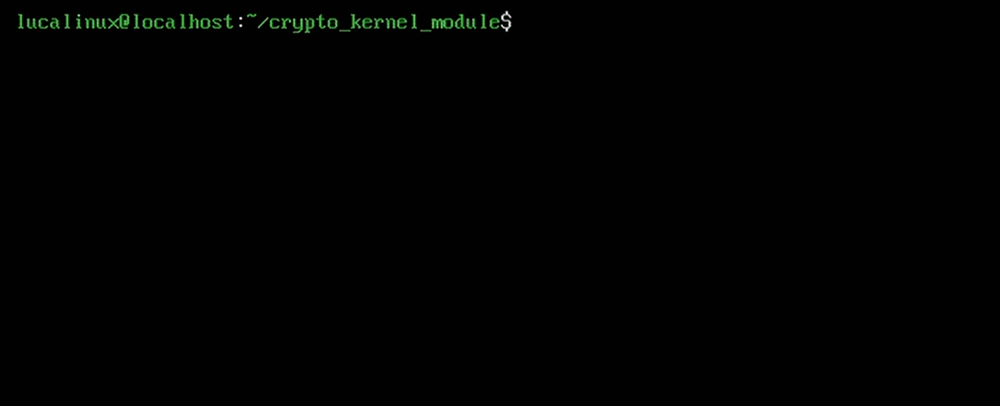

# Linux Kernel Crypto Module Poc 🐧🔒

A custom Linux kernel module implementing a character device (`/dev/crypto_hw`) that performs XOR encryption on data passed from user space.

I built this project as a hands-on exploration of low-level OS architecture, specifically to understand how kernel-space memory management and synchronization primitives work under the hood.



## 🛠️ Technical Concepts Demonstrated
Writing code in Ring 0 means no safety nets. This module implements:
* **Character Device Registration:** Dynamic allocation of Major/Minor numbers using `alloc_chrdev_region` and `cdev_init`.
* **Safe User-Kernel Data Transfer:** Strict usage of `copy_to_user` and `copy_from_user` to prevent kernel panics when accessing user-space pointers (`__user`).
* **Concurrency Management:** Implementation of `mutex_lock` and `mutex_unlock` to prevent race conditions and use-after-free bugs if multiple processes try to read/write the device simultaneously.
* **Kernel Memory Allocation:** Proper usage of `kmalloc` (with `GFP_KERNEL` flag) and `kfree` to prevent memory leaks.
* **Modern Kernel Logging:** Utilizing `pr_info`, `pr_err`, and `pr_fmt` instead of legacy `printk()`.

## 💻 Environment Setup
* **OS:** AlmaLinux 10.2 (RHEL alternative)
* **Hypervisor:** Hyper-V Virtual Machine
* **IDE:** VS Code (Remote via SSH)

## 🚀 How to Build and Run

1. **Compile the module:**
   ```bash
   make
   ```

2. **Inject the module into the kernel:**
   ```bash
   sudo insmod crypto_module.ko
   ```

3. **Find the dynamically assigned Major Number:**
   ```bash
   dmesg | tail -n 10
   # Look for: "Module initialized successfully. Major number is: [NUMBER]"
   ```

4. **Create the device node (replace [MAJOR] with your number):**
   ```bash
   sudo mknod /dev/crypto_hw c [MAJOR] 0
   sudo chmod 666 /dev/crypto_hw
   ```

5. **Test the encryption:**
   ```bash
   echo -n "Hello, how's it going today?" > /dev/crypto_hw
   cat /dev/crypto_hw
   ```

6. **Clean up and remove the module:**
   ```bash
   sudo rm /dev/crypto_hw
   sudo rmmod crypto_module
   ```

## 🔮 Next Steps
Low-level programming is fascinating. While this current version relies on a basic XOR cipher to demonstrate the data flow between user and kernel space, my future roadmap for this project includes:
* Implementing a more advanced cryptographic algorithm (e.g., AES).
* Adding dedicated `ioctl()` commands to allow the user-space application to securely pass a custom encryption/decryption key to the kernel.
* Creating an application the user can use to encrypt and decrypt text without having to learn how to use the bash.